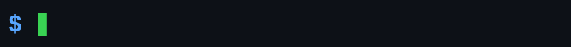

  

  

## Featured Work

### [AI PDF Scanner](https://play.google.com/store/apps/details?id=com.pdfreadermobileapp)

**AI document scanner and PDF toolkit for Android**

Scan, view, organize and understand documents in one app.

- Camera scanning with export to PDF
- Viewing for PDF, Word, Excel and PowerPoint files
- PDF tools for merging, splitting, extracting pages and watermarking
- AI summaries and chat with your documents
- Folders, favorites, search and sharing

`React Native` `TypeScript` `Redux Toolkit` `Firebase` `ML Kit`

---

### [QR Scanner & Barcode Scanner](https://play.google.com/store/apps/details?id=com.qrmobileapp)

**Offline-first QR utility for Android**

Scan, create and manage QR codes on the device, with no account needed.

- Camera, batch and gallery scanning
- QR codes for links, Wi-Fi, contacts, phone, SMS, email and social profiles
- Custom colors, styles and logos with a live preview
- History, saved codes and export to image, TXT or CSV

`React Native` `TypeScript` `ML Kit`

---

### [Nas Cyber Medico](https://play.google.com/store/apps/details?id=com.nascybermedico.app)

**Telemedicine app for patient–doctor care**

Connects patients with doctors from booking through follow-up.

- Doctor profiles, appointment booking and time slots
- Video calls and in-app messaging
- AI chat, triage and symptom checking
- Lab reports, prescriptions and health logs
- Google and Apple sign-in, with push notifications

`React Native` `TypeScript` `Redux Toolkit` `Firebase` `Agora`

---

### [SharkStack Website](https://sharkstack.dev)

**Company website for a software studio**

Marketing site covering the studio's services, work and team.

- Services, portfolio, project detail and about pages
- Pricing, careers, job detail and AI training pages
- AI chatbot, contact form and call booking
- Scroll-driven animation and 3D visuals

`React` `Vite` `Tailwind CSS` `GSAP` `Three.js` `Redux Toolkit`

---

### [BeanMachine](https://bean-machine-tau.vercel.app)

**Interactive pixel-art coffee shop**

A playful web experience set inside a pixel-art coffee shop.

- Animated storefront landing scene
- Shop interior with an order flow
- Loading screen, pixel cursor and sound effects
- Light and dark mode

`React` `Redux Toolkit` `Tailwind CSS` `Vite`

---

### AI Translator

**Multi-language translator for Android**

Translate text, voice and images, with on-device translation for downloaded languages.

- Support for 59 languages with automatic language detection
- Conversation mode, text-to-speech and image translation
- Downloadable language packs for offline use
- Dictionary, history and favorites

`React Native` `TypeScript` `Redux Toolkit` `ML Kit` `SQLite`

---

### Quantum Edge Mobile

**Real estate investment app**

Tools for analyzing properties and tracking an investment portfolio.

- Comparative market analysis (CMA) tool
- Portfolio, budget, investment capacity and scenario screens
- AI assistant chat
- Firebase sign-in and subscription plans

`React Native` `TypeScript` `Redux Toolkit` `Firebase`

 

<h3><code>izza@github ~ $ ./contributions.sh</code></h3>
<!-- Snake lives on the `output` branch, generated by .github/workflows/snake.yml.
     It appears after that workflow runs once (Actions tab -> Generate snake animation). -->
<picture>
  <source media="(prefers-color-scheme: dark)" srcset="https://raw.githubusercontent.com/Izza-niazi/Izza-niazi/output/github-snake-dark.svg" />
  <source media="(prefers-color-scheme: light)" srcset="https://raw.githubusercontent.com/Izza-niazi/Izza-niazi/output/github-snake.svg" />
  
</picture>

  

<h3><code>izza@github ~ $ whoami</code></h3>
<table>
  <tr>
    <td valign="top"></td>
    <td valign="top"></td>
  </tr>
</table>

 

<h3><code>izza@github ~ $ ./streak.sh</code></h3>

  

<h3><code>izza@github ~ $ cat stack.txt</code></h3>

  

<h3><code>izza@github ~ $ ./connect.sh</code></h3>

<!--
  Regeneration cheat-sheet
  ------------------------
  Static (rerun when your photo / details change):
    python scripts/prep_photo.py source-photo.jpg && python scripts/make_ascii_svg.py
    python scripts/make_info_card.py
    python scripts/make_typing_svg.py          # edit PHRASES in the script first
    python scripts/make_stack_svg.py           # edit TECHS in the script first
    python scripts/make_pixel_svg.py           # retro pixel-art arcade banner

  Daily automation (.github/workflows/update-profile-art.yml):
    python scripts/fetch_contributions.py      # scrape public calendar, no token
    python scripts/render_streak_svg.py        # -> streak-stats.svg

  The contribution graph itself is the snake (.github/workflows/snake.yml),
  which commits SVGs to the `output` branch twice a day.

  GitHub markdown gotchas: inline style="" is stripped (use   for spacing);
  <h1>/<h2> draw a full-width rule (use <h3>); no JS, no external CSS — all
  animation lives inside each self-hosted SVG.
-->
